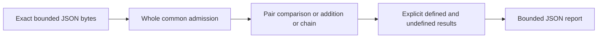

# Serial-number arithmetic lab

Offline Python stdlib teaching tool for invented RFC1982 serial operands. It preserves
undefined half-range comparisons and additions, with ordinary numeric controls.
Defined serial relations do not establish global order, freshness, chronology or trust.

## Run

Intended Python3.11+, verified locally on Windows CPython3.13.7. No dependency needed
for the application; installed Bandit1.9.4 used only for verification.

```powershell
python serial_lab.py --help
python serial_lab.py examples/defined.json
python serial_lab.py examples/mixed.json
python serial_lab.py examples/invalid-late.json
Get-Content -Raw examples/empty.json | python serial_lab.py -
python -B -m unittest discover -s tests -v
python -O -B -m unittest discover -s tests -v
python verification/verify.py
```

Run in this directory; supply absolute script/fixture paths when elsewhere. Use only
invented-number JSON files or bounded stdin, not devices/actual counters/captures.
API: `analyze(data: bytes) -> dict`, raises LabError before returning on invalid input
or output-cap failure; mathematically undefined results remain report data.

| Example | Exit | Meaning |
|---|---:|---|
| defined.json |0|three defined rows, no undefined checks|
| mixed.json |3|four rows containing undefined outcomes/checks|
| empty.json |0|empty defined envelope|
| invalid-late.json |2|whole envelope invalid, no report|

Help uses fixed output, misuse fixed diagnostic. Exit2 also means input/output/cap
failure. Paths/arguments/data are not echoed. Both writes and flushes checked, including
diagnostics; failed streams detached to avoid CPython shutdown120. A failing output
sink may have received bytes before failure; no atomic delivery claim.

## Concepts and architecture

Width8: 255+1 gives0; comparison255 versus0 is less despite numeric greater. The pair
0/128 has known inequality but undefined serial order. From100, valid +100 then+100
gives200 then44: final44 compares less than100, while one +200 addition is undefined.
Width2 four valid +1 steps return to0. Neither equal endpoints nor defined local steps
recover an epoch or prove freshness. 0<100<200<0 at width8 is a cycle, so no sort API.

A chain can remain status defined while has_undefined=true: a comparison or aggregate
single-add check is undefined, but sequential values are known. Comparison ambiguity
does not stop additions. Undefined addition prevents further steps; later rows are
not_evaluated and final aggregates null. Root contains_undefined/exit3 reflects ANY
undefined attempted check. Invalid JSON/profile input rejects the whole envelope first.



SCHEMA.md is the frozen contract. Raw64KiB/depth6/number tokens11/strings64; exact
integers, width2..32, encoded0..M-1, signed teaching increments-M..M (RFC domain0..H-1),
64cases/16steps per chain/256total; report256KiB. UTF-8 BOM rejected; JSON negative-zero
admitted as integer0; unknown version invalid. No defaults/coercion/masking/truncation.
Lists/fields bounded after raw decoding, not an allocation or hard time/RSS guarantee.

## Verification and limits

28 tests passed normally and optimized. Twenty pre-code hand oracles, all1360 pairs
for widths2..5 checked against independent RFC integer inequalities, and680 defined
small-domain additions checked using enumerated successor paths;300 representative
undefined additions. All admitted widths have half-adjacent/wrap controls. Real normal/
optimized children cover help/usage/report/input failure, OS closed pipes, locally
closed Python streams, and bounded short/flush seams. These are controlled local
checks, not a universal stream/platform proof.

Three required mutations each triggered their intended assertion, source restored and
final tests/compile/Bandit pass. verification/REPORT.md records exact counts, the ECC
self-review correction and receipt hashes. Largest admitted count/width/label/chain
shape produced74934 output bytes. This single measurement is not an exact maximum
proof; conservative shape reasoning and defensive cap retained. Narrow one-byte cap
test is seam-injected, not a demonstrated reachable valid-input overflow.

No candidate installed/executed, network, DNS/zone/TCP engine, real devices/counters,
packet/capture parsing, sorting, history reconstruction or security/freshness verdict.
Other Python/Linux/hosted CI/CodeQL/Scorecard/advisory/dedicated secret-history scanner
and independent audit were not run. Capability mocks cover exercised paths, not host
containment. Original scanner live Linux SYN remains unrun; earlier labs unchanged.

## Reusable verification helper

`python verification/verify.py` from any directory uses installed Python/Bandit. Inputs:
own frozen contract/schema/oracles/examples/source/tests. Outputs: logs, Bandit JSON,
stress metrics, receipt.json and latest-run.json. It checks original frozen hashes,
applies three fixed owned-source mutations one at a time, requires intended assertion
failures, restores exact bytes in finally and clears only this module's three cache
files. Then normal/-O/compile/Bandit/demos run and receipt binds current artifacts.
No installation, downloads, remote execution or sibling imports. Do not run with
concurrent source edits or forcibly terminate during mutation; finally cannot protect
against process kill/power loss. Failed/running latest-run means an old receipt is
historical, not current success. Review logs before treating an assertion failure as
useful regression evidence.

## Sources, license and learning

[RFC1982](https://www.rfc-editor.org/rfc/rfc1982.html) is the arithmetic reference.
RESEARCH.md records pinned actual source/tests/license/CI assessment of sna/seqnum and
why neither was adopted. No candidate code copied; original implementation MIT.
Owned admission/output/helper patterns adapted from Jake's MIT packet/route/framing
labs. AI-assisted: Codex researched/implemented/reviewed/tested; local qwen3.5:2b
extracted four supplied labels, not mathematical expectations. No remote draft or
independent audit. See LEARNING/DECISIONS/SECURITY and STATE for authoritative context.

Optional exercise: at width8, predict start0 increments[64,64,1]. Explain why the
second comparison is undefined while the third addition still has a known result.

## Publication status

See [publication review](PUBLICATION.md) for the October 5 source snapshot, fresh local checks, evidence boundaries and current hosted-check distinction.
